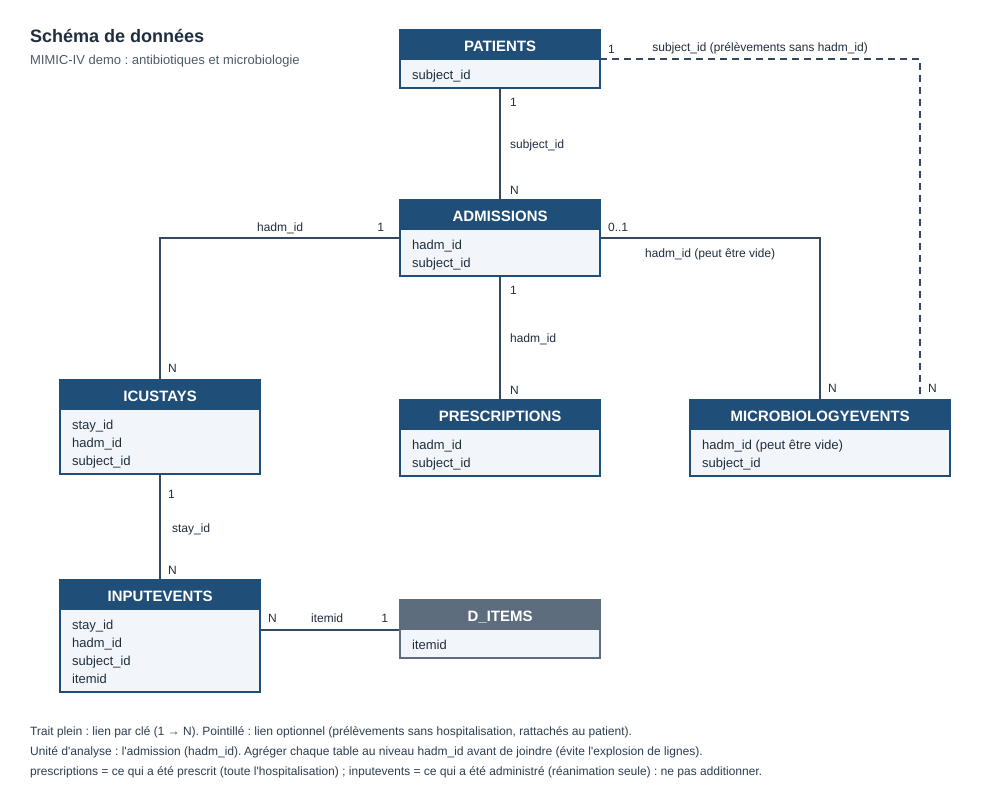

# Consommation d'antibiotiques et microbiologie en milieu hospitalier

Étude exploratoire et prédictive sur MIMIC-IV demo (100 patients) : prescriptions
d'antibiotiques, administrations en réanimation et résultats de microbiologie.

## Données
- [MIMIC-IV Clinical Database Demo v2.2 (PhysioNet)](https://physionet.org/content/mimic-iv-demo/2.2/), accès libre.
- Tables utilisées : patients, admissions, icustays, prescriptions, inputevents,
  d_items, microbiologyevents. Schéma : `docs/schema.md`.
- Les données ne sont pas dans le dépôt.

## Relation des tables

## Pile technique
BigQuery (sandbox) pour l'extraction SQL, Python (Colab) pour l'analyse et le ML, Git.

## Reproduire
1. Télécharger le demo depuis PhysioNet.
2. Charger chaque CSV dans un dataset BigQuery, **toutes colonnes en STRING**
   (la détection automatique échoue sur certaines tables), puis convertir
   avec SAFE_CAST dans les requêtes.
3. Renseigner l'ID du projet et du dataset (voir `.env.example`).
4. Exécuter les requêtes de `sql/` depuis les notebooks.

## Structure
repo/
├─ README.md
├─ requirements.txt
├─ .gitignore
├─ .env.example        # modèle de configuration, sans valeur secrète
├─ docs/
│  └─ schema.md        # schéma de relations
├─ sql/                # une requête = un fichier .sql
├─ src/                # code Python réutilisable (client BigQuery, chargement CSV, nettoyage)
├─ notebooks/          # EDA et ML
└─ exports/            # petits agrégats pour Tableau 

## Limites
Échantillon de 100 patients, dates décalées par patient (pas de dates absolues).

## Crédits et reconnaissance

- **Dataset** : MIMIC-IV Clinical Database Demo, version 2.2
- **Citation** : Johnson, A., Bulgarelli, L., Pollard, T., Horng, S., Celi, L. A., & Mark, R. (2023). *MIMIC-IV Clinical Database Demo* (version 2.2). PhysioNet. https://doi.org/10.13026/dp1f-ex47
- **Auteurs** : Alistair Johnson, Lucas Bulgarelli, Tom Pollard, Steven Horng, Leo Anthony Celi, Roger Mark
- **Licence** : Open Data Commons Open Database License v1.0
- **Financement** : NIH (NIH-R01-EB017205, NIH-R01-EB001659, NIH-R01-GM104987)
- **Remerciements** : Philips Healthcare, le personnel du Beth Israel Deaconess Medical Center et Ken Pierce
- **Notes** : démo de 100 patients dérivée de MIMIC-IV v1.0, sans notes en texte libre, dates décalées de façon cohérente pour la déidentification
